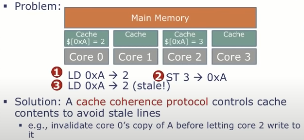
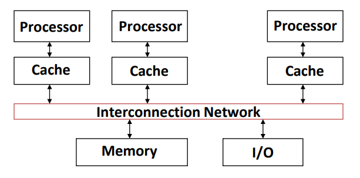
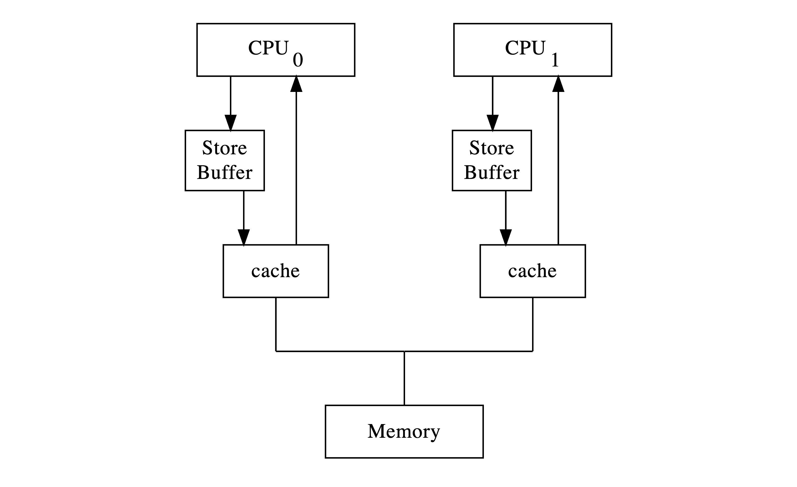
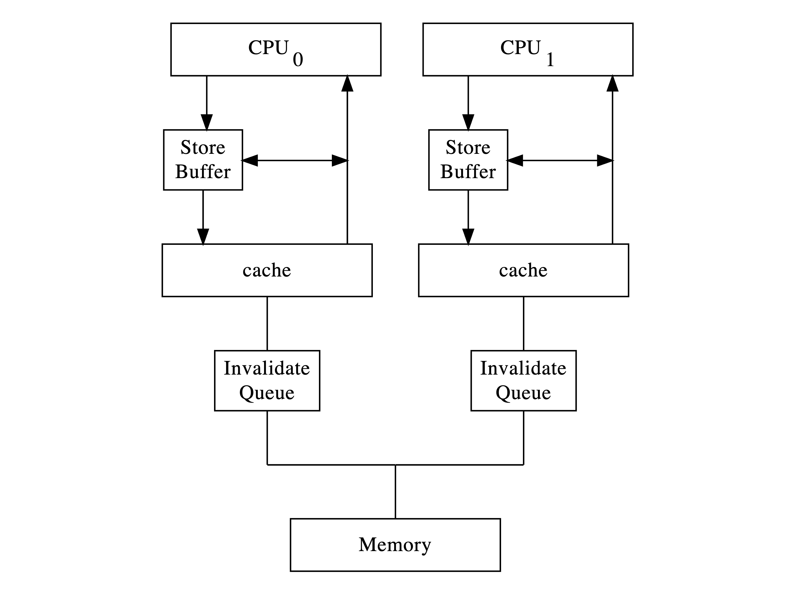
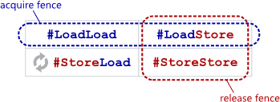

# Understanding the Processor's Local Run Queue in Go's GMP Model Through Ring Buffers

## Introduction
This article is mainly my **notes** from studying [Concurrent Programming: Atomic Operations](https://hackmd.io/@sysprog/concurrency-atomics#%E8%BB%9F%E9%AB%94%E8%A7%80%E9%BB%9E). If you want to learn the ideas below, I recommend reading the full course material. This article covers ring buffers, atomics, memory barriers, cache coherence, false sharing, and lock-free algorithms. It also looks at how Go uses a lock-free ring buffer for the local run queue of a Processor in the GMP model.

[[toc]]

## Ring Buffer
There are two basic ways to implement a ring buffer:

1. Use an extra variable to store the current number of items.
   - `buf.head == buf.tail` can mean either empty or full, so we need a `count` variable to tell the buffer's state.
2. Leave one slot unused.
   - Full: `(buf.tail + 1) % buf.size == buf.head`
   - Empty: `buf.head == buf.tail`
   - Using one less variable can make a lock-free design easier.

Here is the first method:

```go{10,23,37} :collapsed-lines=16
var (
	ErrFull  = errors.New("ring buffer full")
	ErrEmpty = errors.New("ring buffer empty")
)

type RingBuffer[T any] struct {
	data  []T
	head  int
	tail  int
	count int // Tracks whether the buffer is empty or full
	size  int
}

func NewRingBuffer[T any](size int) *RingBuffer[T] {
	return &RingBuffer[T]{
		data: make([]T, size),
		size: size,
	}
}

func (r *RingBuffer[T]) Enqueue(v T) error {
	// The buffer is full when the number of items equals size.
	if r.count == r.size {
		return ErrFull
	}

	r.data[r.tail] = v

	r.tail = (r.tail + 1) % r.size
	r.count++

	return nil
}

func (r *RingBuffer[T]) Dequeue() (T, error) {
	// The buffer is empty when it has no items.
	if r.count == 0 {
		return *new(T), ErrEmpty
	}

	v := r.data[r.head]

	r.head = (r.head + 1) % r.size
	r.count--

	return v, nil
}
```

The second method leaves one slot unused and does not need a `count` variable:

```go{30,43} :collapsed-lines=12
var (
	ErrFull  = errors.New("ring buffer full")
	ErrEmpty = errors.New("ring buffer empty")
)

type RingBuffer[T any] struct {
	data  []T
	head  int
	tail  int
	count int
	size  int
}

func NewRingBuffer[T any](size int) *RingBuffer[T] {
    // One slot is left unused, so size must be at least 2.
     if size < 2 {
		return nil, errors.New("size must be at least 2")
	}

	return &RingBuffer[T]{
		data: make([]T, size),
		size: size,
	}
}

func (r *RingBuffer[T]) Enqueue(v T) error {
	nextTail := (r.tail + 1) % r.size

	// Leave one slot unused.
	if nextTail == r.head {
		return ErrFull
	}

	r.data[r.tail] = v
	r.tail = nextTail

	return nil
}

func (r *RingBuffer[T]) Dequeue() (T, error) {
	var zero T

	if r.head == r.tail {
		return zero, ErrEmpty
	}

	data := r.data[r.head]
	r.data[r.head] = zero

	r.head = (r.head + 1) % r.size

	return data, nil
}
```

The second version may look a little more complex, but it uses the unused slot to tell the difference between an empty and a full buffer. This avoids adding another variable, which would also need to be maintained in concurrent code.

Neither version is thread-safe. A simple test with `go test --trace -v ring_buffer.go` will show many race conditions.

Consider two producers calling `enqueue` at the same time, using the second version. Start with:

```:no-line-numbers
head=0
tail=0
data=[_, _, _]
```

Thread A calls `enqueue(1)`, and Thread B calls `enqueue(2)`. Suppose they run in this order:

```:no-line-numbers
A: reads r.tail = 0
B: reads r.tail = 0

A: nextTail = 1
B: nextTail = 1

A: checks nextTail != head, so it can write
B: checks nextTail != head, so it can write

A: r.data[0] = 1
B: r.data[0] = 2   // Overwrites A's data

A: r.tail = 1
B: r.tail = 1
```

The result is:

```:no-line-numbers
data[0] = 2
tail = 1
```

The value `1` is lost, but both threads think their enqueue succeeded.

We could add a Mutex so only one thread can enter the critical section during enqueue or dequeue:

```go
type RingBuffer[T any] struct {
   data  []T
   mu sync.Mutex // [!code ++]
   ...
}
```

A Mutex has clear meaning and is easy to use, but it also has some limits:

1. It may not use the hardware fully. A blocked thread must spin or wait to wake up.
2. A program may reach a deadlock.
3. It may cause [priority inversion](https://en.wikipedia.org/wiki/Priority_inversion).

If we want to use multiple processors well or improve scalability, we need other ways to handle these cases.

## Atomic
To reduce the limits of mutexes, we could split a lock into smaller parts. For example, we can shard shared variables so each thread works on its own part. This reduces lock contention. But sharding can be too much work for some cases, such as a simple counter. It also does not fit data that should not be split, such as a global flag. In these cases, we can use atomic operations.

> In computer terms, an "atom" is something that cannot be split into smaller steps. This describes the hardware view of a processor instruction, not the software view.
>
> — [Concurrent Programming: Atomic Operations](https://hackmd.io/@sysprog/concurrency-atomics#%E9%98%BB%E5%A1%9E%E5%BC%8F%E5%90%8C%E6%AD%A5%E6%A9%9F%E5%88%B6)

From the software view, a simple `counter++` has three steps: Load, Add, and Store. If atomicity does not make these steps happen together, two threads may load the same value, add one, and store it. The counter should become 2, but it may become 1.

CPUs often provide special instructions for atomic Read-Modify-Write (RMW) operations. Two common types are:

1. [Compare-and-swap (CAS)](https://en.wikipedia.org/wiki/Compare-and-swap) and swap (SWP)
   - SWP writes a value and returns the old value as one atomic operation.
     - ARMv5 and earlier locked the whole system bus. This caused problems on multi-core systems. ARMv6 and later replaced this with LDREX and STREX.
   - CAS changes A to B only if the current value is A. Otherwise, it does not write.
     - Examples include `CMPXHG` on x86 and ARMv8.1.
   - CAS may cause the [ABA problem](https://en.wikipedia.org/wiki/ABA_problem).
2. [Load-link/store-conditional (LL/SC)](https://en.wikipedia.org/wiki/Load-link/store-conditional)
   - These two instructions work as a pair to provide atomicity.
     - LL (Load-Link/Load-Reserved) reads a value and marks the address as exclusive inside the CPU.
     - SC (Store-Conditional) tries to write a new value to the marked address. It succeeds if no one changed the address since LL, then clears the exclusive state. If the address changed, the write fails.
   - Examples include Power and ARMv6 or later, which provides LDREX and STREX.
   - LL/SC can avoid the ABA problem.

## Cache
Early computers had slow CPUs and main memory. CPU speed later increased much faster than main memory speed. Modern computers use cache to reduce how often the CPU needs to access main memory.

::: info
According to [Latency Numbers Every Programmer Should Know](https://gist.github.com/jboner/2841832), reading main memory takes about 100 ns, while an L1 cache read takes about 0.5 ns. That is a 200-times difference.
:::

### Cache Parts
- Cache Size
  - The largest amount of data that the cache can hold.
- Cache Line
  - The cache is split into blocks of equal size. Each block is a cache line.
  - It is the smallest unit moved between cache and main memory.

### How to Find a Cache Hit or Miss
If the CPU reads one byte from a memory address, how does it know whether the data is in cache?

Suppose we have a 64-byte cache. Each cache line is 8 bytes, so there are 8 cache lines. If we read `0x0654`, the cache splits the address into three parts: Tag, Index, and Offset.


Image source: [Zhihu @smcdef](https://zhuanlan.zhihu.com/p/102293437)

- Tag (2 bits)
  - The remaining high bits are the tag. First, look at Index and Offset to understand how it is calculated.
- Index (3 bits)
  - There are 8 cache lines. We use 3 address bits ($\log_{2}8=3$) to find the cache line, shown in yellow in the figure.
- Offset (3 bits)
  - This finds a byte within the 8-byte line, so it needs $\log_{2}8=3\text{ bits}$, shown in blue.

Many addresses can have the same index. The index alone cannot tell us if the data in that cache line belongs to the address we want. A tag array solves this problem. It matches the data array, and each cache line has a tag. The tag stores the address bits left after removing the index and offset, shown in green.

After the index finds a cache line, the CPU compares its tag with the address tag. If they match, it is a cache hit. If they do not match, it is a cache miss.

::: warning
Cache size does not include the tags. It counts only the data.
:::

Cache lines also have flags such as valid and dirty bits. A valid bit tells us whether the data in a cache line is valid. Usually, `1` means valid and `0` means invalid, so it is usually `0` after startup. The CPU checks this bit before comparing tags.

### Mapping Types

#### Direct Mapped
The method above is direct mapped. A modulo operation on the memory address tells us which cache line to use.

- Advantages
  - Simple and easy to calculate.
  - Low hardware cost.
- Disadvantages
  - Cache thrashing: addresses with a fixed offset may use the same cache line. The old line must be evicted and loaded from main memory, causing conflicts.

#### N-way Set-Associative
In an N-way cache, every N cache lines form one set. We calculate which set an address belongs to, then look for an empty line in that set. If no line is empty, we evict one using a policy such as LRU, Random, or FIFO. To find data, we first find the set, then compare tags in that set.

Using the same cache size of 64 bytes and line size of 8 bytes, a 2-way set-associative cache has:

$$
64B \div 8B = 8 \text{ cache lines} \\
8 \text{ cache lines} \div 2 = 4 \text{ sets}
$$

There are 4 sets. The address still has Tag, Index, and Offset. The line size is still 8 bytes, so Offset is still 3 bits. Index now needs to select one of 4 sets, so it needs $\log_{2}4 = 2 \text{ bits}$. The remaining high bits are the Tag. The address format is now `Tag{3 bits}-Index{2 bits}-Offset{3 bits}`.

See the figure:

Image source: [Zhihu @smcdef](https://zhuanlan.zhihu.com/p/102293437)

- Advantages
  - It can reduce cache thrashing. Addresses with the same index go to the same set. The cache can use any free line in that set, or evict one using a replacement policy.
- Disadvantages
  - It costs more hardware than direct mapped.
    - The cache must compare more tags. Parallel comparisons make the hardware more complex.

#### Fully Associative
In a fully associative cache, all cache lines are in one set. We do not need to find a set first; we search all lines for the matching tag.


Image source: [Zhihu @smcdef](https://zhuanlan.zhihu.com/p/102293437)

Since there are no separate sets, we do not need an Index. When writing, the cache can use any empty line. When reading, it checks all tags. This can reduce cache thrashing as much as possible, but it costs more hardware.

#### Summary

|            | Direct-Mapped | N-way Set-Associative |       Fully Associative       |
|:-----------| :---: | :---: |:-----------------------------:|
| Idea         | A memory block can use only **one fixed** cache line | A memory block can use any cache line in **one selected set** | A memory block can use **any** cache line |
| Hardware complexity and cost | Lowest | Medium |              Highest               |
| Space use      | Lowest | Medium |              Highest               |
| Miss Rate  | Highest | Lower |              Lowest               |
| Hit Time   | Fastest | Medium |     Slower<br>(many tags must be checked)     |

For example, my computer uses an M4 chip. The [Apple Silicon CPU Optimization Guide](https://developer.apple.com/download/apple-silicon-cpu-optimization-guide/) lists this in **Table 5.6. L1I Cache Organization: M-Series Chips**:
- M4 Family
  - Performance Cores: 192 KiB, 6-way, 64-byte lines
  - Efficiency Cores: 128 KiB, 4-way, 64-byte lines

For a P-Core, the L1 cache is 192 KiB and each line is 64 bytes:

$$
\begin{aligned}
& 192 \times 1024 = 196{,}608 B \\[0.5em]
& 196{,}608B \div 64B = 3{,}072 \text{ lines} \\[0.5em]
& 3{,}072 \div 6 = 512 \text{ Sets}
\end{aligned}
$$

### Cache Line Experiment
Now that we know the parts of a cache, let us return to the [Cache Line experiment](https://hackmd.io/@sysprog/concurrency-atomics?stext=14501%3A1482%3A0%3A1781338030%3ACIVy3F) in Concurrent Programming: Atomic Operations. It shows that a variable crossing two cache lines may have an unexpected value. This happens because hardware does **not promise atomic reads and writes across cache lines**.

Here is a struct:
```C
struct data {
    int32_t pad[15]; // 4 bytes * 15 = 60 bytes
    int64_t v;       // 8 bytes
};
```

The experiment starts 24 threads. Each thread runs a NOT operation 10,000 times:
```C:no-line-numbers
value.v = ~t;
```

Print the result:
```C
printf("iteration: %lu\n", count);
printf("data size: %lu\n", sizeof(value));
printf("final: %016lX\n", value.v);
```

Watch the output. What will the final value be?
```bash:no-line-numbers
watch -n 1 "./cacheline 24 10000"
```

In theory, `value.v` should be one of these:
1. `FFFFFFFFFFFFFFFF`
2. `0000000000000000`

In practice, four values can appear:
1. `FFFFFFFFFFFFFFFF`
2. `0000000000000000`
3. `00000000FFFFFFFF`
4. `FFFFFFFF00000000`

Cache coherence works with cache lines. To write data, a CPU must get exclusive access to the cache line. If a variable is split across two cache lines, there is no atomic guarantee between those lines. Reads can have the same problem, so other threads may see a torn read or torn write.

As described in Volume 3 of the [Intel® 64 and IA-32 Architectures Software Developer's Manual](https://www.intel.com/content/www/us/en/developer/articles/technical/intel-sdm.html):
> Intel 64 memory ordering guarantees that for each of the following memory-access instructions, the constituent memory operation appears to execute as a single memory access regardless of memory type:
> 
> 1. Instructions that read or write a single byte. 
> 2. Instructions that read or write a word (2 bytes) whose address is aligned on a 2 byte boundary. 
> 3. Instructions that read or write a doubleword (4 bytes) whose address is aligned on a 4 byte boundary. 
> 4. Instructions that read or write a quadword (8 bytes) whose address is aligned on an 8 byte boundary. <br> All locked instructions (the implicitly locked xchg instruction and other read-modify-write instructions with a lock prefix) are an indivisible and uninterruptible sequence of load(s) followed by store(s) regardless of memory type and alignment. 
> 
> Other instructions may be implemented with multiple memory accesses. From a memory-ordering point of view, there are no guarantees regarding the relative order in which the constituent memory accesses are made. There is also no guarantee that the constituent operations of a store are executed in the same order as the constituent operations of a load.

Declaring the same struct in Go does not place `v` across two cache lines, because Go aligns the field. To run this experiment, we must set the offset by hand.

The following Go code shows how Go aligns this struct:
```go
type Data struct {
	Pad [15]int32 // 4 bytes * 15 = 60 bytes
	V   int64     // 8 bytes
}

func main() {
  var d Data

  fmt.Printf("1. Struct size: %d bytes\n", unsafe.Sizeof(d))
  fmt.Printf("2. Struct alignment: %d bytes\n", unsafe.Alignof(d))

  fmt.Printf("Pad offset: %d, size: %d\n", unsafe.Offsetof(d.Pad), unsafe.Sizeof(d.Pad))
  fmt.Printf("V   offset: %d, size: %d\n", unsafe.Offsetof(d.V), unsafe.Sizeof(d.V))
}
```

The output is:
```:no-line-numbers
1. Struct size: 72 bytes
2. Struct alignment: 8 bytes

Pad offset: 0, size: 60
V   offset: 64, size: 8
```

## Cache Coherence
Cache helps reduce slow reads from main memory. But on a multi-core processor, different cores may read or change the same data. This creates a new problem: keeping the data consistent. For example:

<br>
Image source: [MIT 6.004 L25: Cache Coherence](https://youtu.be/83jOKVb_HTM)

Steps:
1. $Core_0$ reads address `0xA`, which contains `2`.
2. $Core_2$ writes `3` to `0xA` in its cache. It will write the data back to memory later.
3. $Core_0$ does not know about the update by $Core_2$, so it still thinks `0xA` contains `2`. This value is now stale.

We need a way to keep data consistent. A protocol for this is called a Cache Coherence Protocol. Before a CPU writes data, it can broadcast a PrWr (Probe Write) request. Other CPUs with the same cache line invalidate their copies. After their invalidate acknowledgements arrive, the CPU can write to its cache and write the data back to memory later.

> When using a cache, each CPU should see consistent (coherent) data. The focus is the order between CPUs, not keeping cache and memory synchronous. This difference can affect the system design.
>
> [Concurrent Programming: Atomic Operations](https://hackmd.io/@sysprog/concurrency-atomics)

CPUs communicate through the [system bus](https://en.wikipedia.org/wiki/System_bus), which connects CPUs, main memory, and other I/O devices. For cache coherence, CPUs send Probe Read or Probe Write requests through the bus, and other CPUs reply through it. The system bus is also called a cache-coherent interconnect (CCI).



### MESI Protocol
[MESI Protocol](https://en.wikipedia.org/wiki/MESI_protocol) is one Cache Coherence Protocol. It helps us understand data consistency from the CPU's point of view.

States:
- Modified (M)
  - The cache line exists only in this cache and is **dirty**, which means its value is different from main memory.
- Exclusive (E)
  - Only this cache has the line, and its value matches main memory.
- Shared (S)
  - Several caches have the line, and its value matches main memory.
- Invalid (I)
  - The cache line is invalid or unused.

For example:
1. When $CPU_0$ reads a block for the first time, its cache line changes from Invalid to Exclusive.
2. $CPU_1$ also wants to read the block and broadcasts PrRd. Since $CPU_0$ has the data, it sends a copy to $CPU_1$, and both cache lines become Shared.
3. $CPU_0$ wants to write to the block. Its cache line becomes Modified, and it broadcasts PrWr to other CPUs. Since $CPU_1$ also has the data, its cache line becomes Invalid.
4. When $CPU_1$ reads the data, it broadcasts PrRd. Since $CPU_0$ has the data in Modified state, it writes the data back to main memory and changes its state to Shared. Then $CPU_1$ reads the data from $CPU_0$. Its cache line should also become Shared.

## Store Buffer

Suppose $CPU_0$ wants to change a variable, and its cache line is in Shared state. This means another core may also have a copy. Before writing, $CPU_0$ must get write access and invalidate the other copies. It can finish the write after it receives the invalidate acknowledgements.

Messages take time to move between cores. If each write must wait for all of these steps, the CPU may stall. Modern CPUs use a Store Buffer to reduce this wait.

When the CPU runs a store instruction, it can first put the address and data in the store buffer. Later instructions may continue while the hardware gets write access and updates the cache.



So **a CPU running a write instruction does not mean other cores can already read the new value**.

### Store-To-Load Forwarding
Can a CPU fail to read its own recent write?

Consider these operations on one core:
```:no-line-numbers
Store x = 1
Load x
```

If `x=1` is still in the store buffer, the cache still has the old value. To keep correct behavior for one thread, the CPU can take the pending value from the store buffer and return it to the load. This is called Store-to-Load Forwarding.

The core that made the write can now read the new value, but other cores may still read the old value because the write is not visible to them yet.

### Cache Coherence Is Not Enough

Suppose `x = 0` and `y = 0`, and they are in different cache lines:

```:no-line-numbers
    CPU0               CPU1
------------       ------------
Store x = 1        Store y = 1
Load y -> r0       Load x -> r1
``` 

It may seem that since each core writes before it reads, at least one core must read `1`. But a memory model that allows this behavior may produce:
- `r0 = 0`
- `r1 = 0`

The store buffer of $CPU_0$ has the new `x`, but $CPU_0$ reads `y`. The store buffer of $CPU_1$ has the new `y`, but $CPU_1$ reads `x`. If the writes are still in the store buffers when the reads finish, it can look as if each Load ran before its Store.

## Memory Ordering
Even if a program says "write first, then read," other cores may not see the result in that order. So **which memory access orders can we rely on?**

The rules and guarantees from a processor or programming language are called Memory Ordering.

### Sequential Consistency

Use the example above:
```:no-line-numbers
    CPU0               CPU1
------------       ------------
Store x = 1        Store y = 1
Load y -> r0       Load x -> r1
``` 

Suppose:
- $CPU_0$ must do `Store x=1` before `Load y`.
- $CPU_1$ must do `Store y=1` before `Load x`.

If $CPU_0$ completes both operations first, then $CPU_1$ runs, the result is `(0, 1)`:
1. $CPU_0$ writes x = 1.
2. $CPU_0$ reads y and gets 0.
3. $CPU_1$ writes y = 1.
4. $CPU_1$ reads x and gets 1.

If both cores write first and then read, the result is `(1, 1)`.

As long as **each core keeps its write-before-read order, no order of these operations can make both cores read 0**.

This model, where **each core keeps its own operation order and all operations look as if they happened one by one in an interleaved order**, is called **Sequential Consistency (SC)**.

In this model, all operations look as if they happened in order, while each core keeps its original order.

:::warning
The hardware does not have to run only one operation at a time. The result only needs to follow this model.
:::

We may think that multiple cores only interleave their operations. **But real hardware may allow results beyond this idea.** As the store buffer example showed, both cores may read `(0, 0)`. This result cannot be explained by keeping each core's order and interleaving the operations.

So on hardware that allows this behavior, normal memory reads and writes may not follow the sequential consistency we expect.

### Which Orders Can Be Relaxed?

We should not assume that all operations always run in the order shown above. We need to ask: **which order between two memory accesses is guaranteed?**

There are four pairs of access types:

| Order | Question |
| :---: | :---: |
| Load -> Load | Is the first read guaranteed to happen before the next read? |
| Load -> Store | Is the first read guaranteed to happen before the next write? |
| Store -> Store | Is the first write guaranteed to happen before the next write? |
| Store -> Load | Is the first write guaranteed to happen before the next read? |

:::info
Here, order means the order guaranteed by the memory model and visible to observers. It does not only mean the order in which instructions enter the CPU.
:::

**Different architectures give different guarantees.** They do not always relax all four orders. The store buffer example shows that Store -> Load for different addresses may be relaxed. It does not mean that the same architecture also allows Store -> Store reordering.

So seeing A before B in the code does not mean every core will see them in the same order.

### Summary

#### Cache Coherence and Memory Ordering
- Cache coherence
  - Keeps the order of writes to the same memory location consistent across cores.
- Memory ordering
  - Also defines the order between different memory accesses.

In the earlier example, $CPU_0$ and $CPU_1$ both read the initial values, and their writes became visible later. The order of writes to x and y did not change, but when we look at both variables together, the result **does not follow sequential consistency**.

#### The Compiler Matters Too
The hardware examples above help us focus on CPU behavior.

Real programs also pass through a compiler. Within the language rules, the compiler may reorder, combine, or remove memory accesses. When writing concurrent programs, we need to think about two things:
1. What the programming language allows the compiler to do.
2. What memory access results the processor allows.

This is why we cannot test CPU memory ordering by changing the hardware example into normal Go variable reads and writes. Unsynchronized shared access may be a data race. We must first check the language memory model, such as the [Go Memory Model](https://go.dev/ref/mem).

## Memory Barrier

In the memory ordering example, both cores wrote first and then read, but they could still both read 0. One possible reason is that both writes were still in their store buffers, while each later read saw the other core's old value. If our algorithm cannot allow this result, we need to limit the order of the operations. A **Memory Barrier** provides these kinds of ordering guarantees.

To order the writes and reads, put a Full Memory Barrier between Store and Load on both cores:
```:no-line-numbers
CPU 0                 CPU 1
──────────────────    ──────────────────
Store x = 1           Store y = 1
Full Barrier          Full Barrier
Load y -> r0          Load x -> r1
```

The barrier must guarantee that the Store before it stays before the Load after it. This rules out both cores reading 0.

We can understand this in two cases:
1. If $CPU_0$ still reads `y = 0`, then $CPU_1$'s write was not visible before that read. But the barrier keeps $CPU_0$'s `x = 1` in the required order, so when $CPU_1$ later reads `x`, it cannot get `0`.
2. The reverse is also true. If $CPU_1$ reads `x = 0`, then it must read `y = 1`.

After adding the required barriers, possible results `(r0, r1)` include:
1. `(0, 1)`
2. `(1, 0)`
3. `(1, 1)`

The result `(0, 0)` is no longer allowed.

- A barrier removes results that do not follow the required order. It does not decide which core runs first.
- A barrier does not mean data is written back to main memory.
- A memory barrier defines the required order of memory accesses before and after it.

Hardware may provide these guarantees by waiting for writes in the store buffer to progress or by limiting later accesses. The details depend on the architecture and instruction, so it is not correct to describe every barrier as "clearing the store buffer" or "stopping all instructions."

### Barrier Types
Different barriers provide different guarantees. The example above orders Store -> Load, but some cases only need order between reads or between writes.

Common barrier types:
| Type | Main ordering guarantee |
|---|---|
| Read Barrier | Reads before the barrier happen before reads after it. |
| Write Barrier | Writes before the barrier happen before writes after it. |
| Full Barrier | Orders both reads and writes, including the Store -> Load order needed above. |

The compiler may also change memory accesses when the language rules allow it.

So we need to separate two levels:
- Compiler barrier: limits compiler reordering or other optimizations for certain memory accesses.
	- A compiler barrier tells the compiler that memory operations must not move across the barrier during optimization. It does not always create a CPU barrier instruction.<br>For example, GCC can use an empty assembly statement with a "memory" clobber:
		```C
		asm volatile("" ::: "memory");
		```
		— [Compiler Barrier - Concurrent Programming: Atomic Operations](https://hackmd.io/@sysprog/concurrency-atomics#%E8%BB%9F%E9%AB%94%E8%A7%80%E9%BB%9E)
	- Go has no public interface for a separate compiler barrier. Instead, synchronization operations such as Atomic, Mutex, and Channel provide the required order.
- CPU memory barrier: limits the memory access order the processor may produce.

### Barrier Cost

Processors use tools such as Store Buffers to reduce waiting. A barrier requires some operations to keep their order, so it may reduce work that could otherwise overlap. This does not mean that fewer barriers are always better. First check what guarantees the algorithm needs, <span class="text-red">which operations must happen before others, and which wrong results those guarantees prevent</span>. Then choose a synchronization method that provides those guarantees.

## Invalidate Queue

A Store Buffer helps the core that writes data wait less, but other cores also need to invalidate their copies of the cache line. The Store Buffer is small, too. If the receiving core cannot handle an invalidation request right away and the writer's Store Buffer is full, the writer still has to wait.

So we can keep invalidation requests in a queue at the receiving end. This is called an Invalidate Queue.

The cache design now looks like this:


When a CPU gets an invalidate message, it can first put the request in the Invalidate Queue and send an acknowledgement (ACK). It can handle the local invalidation later. This reduces the sender's wait, <span class="text-red">but it means two things happen at different times</span>:
- The request has arrived and been accepted.
- The local invalidation has finished.

This design must still follow cache coherence rules. It must handle later related requests in the required order and cannot ignore an accepted invalidation request.

:::warning
An ACK from the sender does not prove that all later reads on the receiving CPU have the required ordering guarantees.
:::

Consider this case:
- $CPU_0$ prepares data, then sets a flag to tell $CPU_1$ that the data is ready.
- At the start, `data = 0` and `ready = 0`, and they are on different cache lines.

```:no-line-numbers
CPU 0                 CPU 1
──────────────────    ──────────────────
Store data = 42       Keep reading ready
Write Barrier         Until it reads ready = 1
Store ready = 1       Load data -> result
```

$CPU_0$ uses a write barrier to keep the data write before the ready notification. But after $CPU_1$ sees `ready = 1`, **it may not read `data = 42` on an architecture without the matching read-order guarantee**. <span class="text-red">A barrier on the writer alone may not provide the order needed for the full handoff.</span>

From the Invalidate Queue point of view:
1. Suppose $CPU_1$ already has the old `data = 0` in its cache.
2. $CPU_0$ prepares to write `data = 42` and sends an invalidate request to $CPU_1$.
3. $CPU_1$ puts the request in its Invalidate Queue and sends an ACK, but has not handled it locally yet.
4. $CPU_0$ gets write access, writes the data, and then publishes `ready = 1` as required by the write barrier.
5. $CPU_1$ reads `ready = 1`.
6. Without the matching read-order rule, $CPU_1$ may still read the old data.

For this handoff to work as expected, $CPU_1$ must first see ready, then read data in the required order:

```:no-line-numbers
CPU 0                 CPU 1
──────────────────    ──────────────────
Store data = 42       Keep reading ready
Write Barrier         Until it reads ready = 1
												Read Barrier
Store ready = 1       Load data -> result
```

With a barrier pair that provides the required guarantees, if $CPU_1$ reads this published `ready = 1`, its later read must get `data = 42`. This assumes no other writer changes data or ready again.

We can think of a read barrier as requiring the hardware to handle the needed invalidations so later reads follow the order. But clearing the Invalidate Queue is not the general definition of a read barrier. A barrier defines an ordering guarantee; the processor architecture decides how to provide it.

## Acquire and Release in C++

The examples above describe hardware behavior. When writing this data handoff in C++, which tools keep the required order across both the compiler and processor?

### From a Hardware Example to C++ Code

Using the Invalidate Queue example, the writer must write data before publishing ready. The reader must see ready before reading data:

```:no-line-numbers
Writer                         Reader
──────────────────────        ──────────────────────
Write data = 42                Keep reading ready
Keep the required order       Until it reads true
Write ready = true             Keep the required order
                              Read data
```

First, declare the shared variables in C++:

```C++
#include <atomic>

int data = 0;
std::atomic<bool> ready{false};
```

data holds the value to pass, and ready is an atomic variable used to send a notification. Assume initialization finishes before either thread starts. The writer and reader each run once, and no other operation changes data or ready.

Using atomic makes parallel reads and writes of ready atomic. But **atomicity alone does not create the synchronization that data needs**.

C++ lets us choose the ordering for an atomic operation. For example, `memory_order_relaxed` keeps the operation atomic and keeps the modification order for the same object. But relaxed operations alone do not create the cross-thread synchronization (`synchronizes-with`) needed for data here.

In C++, `std::atomic_thread_fence` can express a separate ordering requirement. A fence does not read or write ready and does not replace an atomic access. This example needs both.

## Fence Types
1. **Full Fence**

	A Full Fence `std::atomic_thread_fence()` between operations prevents those operations from being reordered. However, Store-Load operations may still be reordered.
2. **Acquire Fence**

	`std::atomic_thread_fence(std::memory_order_acquire)` prevents a load from moving after the barrier.

3. **Release Fence**

	`atomic_thread_fence(std::memory_order_release)` prevents a store after the fence from moving before it.

This gives us these orders:
- acquire fence = LoadLoad + LoadStore barrier
- release fence = LoadStore + StoreStore barrier

The relationship is shown here:



#### Release Fence: Prepare Data, Then Publish a Notice

The writer can use:

```C++
void publish() {
    data = 42;
    std::atomic_thread_fence(std::memory_order_release);
    ready.store(true, std::memory_order_relaxed);
}
```

First, look at the operations on each side of the fence:

```:no-line-numbers
Store data = 42
       │
  release fence
       │
Store ready = true
```

The required order is **Store data -> Store ready**: prepare the data first, then publish ready.

A release fence also orders loads before the fence and stores after it:

```:no-line-numbers
Load ──┐
       ├── release fence ──> Store
Store ─┘
```

So diagrams often call these LoadStore and StoreStore. The names show the operation types before and after the fence. For example, StoreStore means a write before the fence and a write after it.

#### Acquire Fence: Receive the Notice, Then Use the Data

The reader waits for ready, then runs an acquire fence, and finally reads data:

```C++
void receive() {
    while (!ready.load(std::memory_order_relaxed)) {
        // Wait for the writer's notice.
    }

    std::atomic_thread_fence(std::memory_order_acquire);
    assert(data == 42);
}
```

The loop ends when the last load reads the `true` written by the writer. The operations on each side of the fence are:

```:no-line-numbers
Load ready and read true
       │
   acquire fence
       │
   Load data
```

The required order is **Load ready -> Load data**: first see the notice, then use the data. The `while` loop waits. The acquire fence helps create the synchronization needed to read the data. They have different roles.

An acquire fence also orders later writes:

```:no-line-numbers
                                ┌──> Load
Load ── acquire fence ──────────┤
                                └──> Store
```

So diagrams often call these LoadLoad and LoadStore. Later work may read data or change it.

| Fence | Basic order |
|---|---|
| Release fence | Earlier Load/Store -> later Store |
| Acquire fence | Earlier Load -> later Load/Store |

:::info
This table helps explain the order. It is not a list of instruction reordering rules written directly in the C++ standard.<br>
C++ defines the allowed results through synchronization. In this example, the atomic read and write of ready must connect the two sides. We cannot rely only on putting one fence on each side.
:::

<span class="text-red">When the reader's atomic load reads the `true` written by the writer's atomic store, and the two fences are in the positions above, the release and acquire fences synchronize.</span><br>The related rules are in [the C++ standard draft, atomics.fences](https://eel.is/c++draft/atomics.fences#2).

Combining the basic effects of an acquire fence and a release fence does not add a **StoreLoad** guarantee.

### Put the Ordering on Atomic Store and Load

We can also put the ordering directly on the atomic operations of ready:

```C++
void publish() {
    data = 42;
    ready.store(true, std::memory_order_release);
}

void receive() {
    while (!ready.load(std::memory_order_acquire)) {
        // Wait for the writer's notice.
    }

    assert(data == 42);
}
```

There is no separate fence here. The selected atomic operations provide the ordering:
- **Release store**: includes the data preparation before publication in the synchronization from this store.
- **Acquire load**: after it reads this publication, later data use is protected by synchronization.

```:no-line-numbers
Write data
    │
    ▼
release store ready

acquire load ready reads this published true
    │
    ▼
Read data
```

Both examples provide the required handoff here. A fence is a separate operation, while release-store and acquire-load ordering belongs to a selected atomic access. They are not general replacements for each other in every program.

- Fence version: ordering is on the fences. The relaxed store and load of ready connect the synchronization between the fences.
- Atomic version: ordering is on the store and load of ready.

Release and acquire are not options that can be used on any load or store. An atomic store can use release, and an atomic load can use acquire. A store cannot use acquire, and a load cannot use release.

### Why Does This Guarantee the Data?

Using the release-store and acquire-load version, we can split the handoff into four operations:

```:no-line-numbers
Writer                              Reader

A: Write data = 42
       │
       ▼
B: release store ready = true ────> C: acquire load ready reads true
                                          │
                                          ▼
                                      D: Read data
```

There are three relationships:
1. **A -> B**: The writer writes data before it publishes ready. This is a `sequenced-before` relationship in one thread.
2. **B -> C**: The reader's acquire load reads the true written by this release store. This creates a cross-thread `synchronizes-with` relationship.
3. **C -> D**: The reader checks ready before reading data. This is also `sequenced-before`.

Together, these relationships give us <span class="text-red">**A happens-before D**</span>. If nothing else changes the data, D must read the 42 written by A. This is why the normal variable data is still protected by synchronization through ready.

These rules are in [atomics.order](https://eel.is/c++draft/atomics.order#2) and [intro.races](https://eel.is/c++draft/intro.races). This ordering is provided by the language. It does not depend on whether the CPU has a particular store buffer or invalidate queue.

| Term | Meaning |
|---|---|
| `sequenced-before` | Order between operations in one thread |
| `synchronizes-with` | A link between threads made by synchronization operations that meet the rules |
| `happens-before` | The order made by joining the relationships above; it describes visibility, not execution time |
| `modification order` | The order of all changes to the same atomic object |
| SC total order | The shared order that SC operations and fences must follow |

[Concurrent Programming: Execution Order](https://hackmd.io/@sysprog/concurrency-ordering)

### Go

The article is about Go, so why did we use C++ to explain ordering? **C++ gives programmers options such as relaxed, acquire, release, and seq_cst, so we can compare their guarantees in the same example. Go's public sync/atomic API always provides sequentially consistent behavior and does not offer these choices.**

This does not mean Go does not need memory ordering. Go asks the compiler and runtime to meet the promises of its public API. Application code does not choose a weaker order.

#### Go Memory Model: Reads and Writes Across Goroutines Need Synchronization

The [Go Memory Model](https://go.dev/ref/mem) defines when a read in one goroutine is guaranteed to see a write in another goroutine.

It also uses happens-before reasoning. The order inside one goroutine and synchronization created by channels, mutexes, and atomics can form an order across goroutines. If multiple goroutines access a normal variable and at least one writes to it, we need proper synchronization. We cannot decide that it is safe just because "the other goroutine should be done" or because we waited for some time.

Go provides **DRF-SC (Data-Race-Free Sequential Consistency)**: a program without data races can be explained by an interleaving that keeps each goroutine's order. This does not mean all shared access is safe by default. Removing data races is required for this guarantee.

The [sync/atomic documentation](https://pkg.go.dev/sync/atomic#pkg-overview) clearly states two things:

1. If atomic operation B observes the effect of atomic operation A, then A synchronizes before B.
2. All atomic operations in a program behave as if they ran in one sequentially consistent order.

So we can write the earlier data handoff in Go like this:

```go
var data int
var ready atomic.Bool

// Publisher: called only once.
func publish() {
    data = 42
    ready.Store(true)
}

// Receiver
func receive() int {
    if ready.Load() {
        return data // Guaranteed to be 42.
    }
    return 0 // The notice has not arrived in this check.
}
```

This also assumes initialization is complete, and nothing else changes data or resets ready. When the receiver reads the true written by this Store, synchronization makes the write to data happen before the later read.

This Go example checks only once on purpose. If we need to wait for a notice, we can use a channel or another waiting method in real code. This avoids keeping a goroutine busy just to show synchronization.

Here, Go's `ready.Store` and `ready.Load` provide both the data handoff guarantee of a C++ release/acquire pair and a shared SC order. For example, if we change all four accesses to x and y in the earlier example to Go atomic Store and Load, both sides will no longer be able to read 0.

## Wait-Free and Lock-Free

Atomic instructions can be used to build [wait-free](https://en.wikipedia.org/wiki/Non-blocking_algorithm#Wait-freedom) and [lock-free](https://en.wikipedia.org/wiki/Non-blocking_algorithm#Lock-freedom) algorithms:

- Wait-free: every operation finishes in a limited number of its own steps.

	No matter how the operating system schedules threads, **every** thread continues to make progress. Other threads can be slow, paused, or competing, but they cannot make this operation wait forever.

- Lock-free: the system keeps completing operations.

	This is a weaker promise. No matter how the operating system schedules threads, at least **one** thread makes progress and the system keeps moving. A single call may still never finish. For example, use CAS to update a counter:

	```go
	func Increment(counter *atomic.Uint64) {
	    for {
	        old := counter.Load()
	        if counter.CompareAndSwap(old, old+1) {
	            return
	        }
	    }
	}
	```

:::warning
We may expect lock-free or wait-free algorithms to be faster than locks, but sometimes the opposite is true:
- Lock-free and wait-free code must handle more race conditions and ABA problems. The code can be more complex than code using a lock.
- When mutex users compete, some threads sleep while the thread holding the lock quickly finishes a group of steps. This can improve throughput.
:::

Mutex performance often gets worse because:
1. The critical section is long and runs often.
2. There is heavy contention, which greatly increases context switching.

The value of lock-free and wait-free algorithms is their promise that one or all threads keep making progress.

### Single Producer Single Consumer (SPSC)

The earlier ring buffer cannot be safely used by many goroutines at the same time. Now we limit it to one Producer and one Consumer (SPSC):

- Only one Producer calls Enqueue.
- Only one Consumer calls Dequeue.
- The Producer and Consumer can run at the same time.

The Producer does not compete with other producers for a write position, and the Consumer does not compete with other consumers for a read position. But both sides still need to read the index changed by the other side. So head and tail use `atomic.Uint64` to create the synchronization needed to pass data.

```go:collapsed-lines=50 title="spsc_ring_buffer.go"
var (
	ErrFull  = errors.New("ring buffer full")
	ErrEmpty = errors.New("ring buffer empty")
)

type SPSCRingBuffer[T any] struct {
	data []T
	size uint64

	_ cpu.CacheLinePad // Separate from the metadata before it.

	head atomic.Uint64

	_ cpu.CacheLinePad // Avoid false sharing between head and tail.

	tail atomic.Uint64

	_ cpu.CacheLinePad // Separate from other data.
}

func NewSPSCRingBuffer[T any](size int) (*SPSCRingBuffer[T], error) {
	if size < 2 {
		return nil, errors.New("size must be at least 2")
	}

	return &SPSCRingBuffer[T]{
		data: make([]T, size),
		size: uint64(size),
	}, nil
}

// Call only from one Producer.

func (r *SPSCRingBuffer[T]) Enqueue(v T) error {
	tail := r.tail.Load()
	nextTail := (tail + 1) % r.size

	if nextTail == r.head.Load() {
		return ErrFull
	}

	r.data[tail] = v

	// Publish the new tail only after writing the data.
	r.tail.Store(nextTail)

	return nil
}

// Call only from one Consumer.

func (r *SPSCRingBuffer[T]) Dequeue() (T, error) {
	var zero T
	head := r.head.Load()

	if head == r.tail.Load() {
		return zero, ErrEmpty
	}

	value := r.data[head]
	r.data[head] = zero

	// Allow reuse only after reading and clearing the value.
	r.head.Store((head + 1) % r.size)

	return value, nil
}
```

### Single Producer Multiple Consumer (SPMC)

With multiple consumers, we must stop them from reading the same item. We cannot only change Store to CAS. Consider two consumers that both read `head=0`:

```:no-line-numbers
A: reads data[0]
B: reads data[0]

A: CAS head succeeds
B: CAS head fails and retries
```

CAS seems to decide who gets the item, but there is a problem:

```:no-line-numbers
A: reads head = 0, then pauses
B: reads data and CAS succeeds, moving head forward
Producer: loops back and overwrites data[0]
A: resumes and reads data[0]
```

Even if A's CAS later fails, **its earlier read of normal data[0] may still race with the Producer's write**.

Doing CAS before reading does not work either:
```:no-line-numbers
A: CAS succeeds and moves head, but has not read the data yet
Producer: sees the new head and thinks it can reuse the slot
Producer: overwrites the data
A: reads the overwritten value
```

So we need another way to protect the lifetime of the data:

1. Store an `atomic.Pointer` at each position. It points to data that is not changed after publication.
2. The Consumer reads the data pointer first, then uses CAS to decide if it successfully took the item.

```go:collapsed-lines=50 title="spmc_ring_buffer.go"
var (
	ErrFull  = errors.New("ring buffer full")
	ErrEmpty = errors.New("ring buffer empty")
)

type entry[T any] struct {
	value T // Do not change after publication.
}

type SPMCRingBuffer[T any] struct {
	data []atomic.Pointer[entry[T]] // Atomic pointers prevent a data race when the Producer replaces a pointer while a Consumer reads it.
	size uint64

	_    cpu.CacheLinePad
	head atomic.Uint64
	_    cpu.CacheLinePad
	tail atomic.Uint64
	_    cpu.CacheLinePad
}

func NewSPMCRingBuffer[T any](size int) (*SPMCRingBuffer[T], error) {
	// A power-of-two size keeps the array index correct when the uint64 counter wraps around.
	if size < 2 || size&(size-1) != 0 {
		return nil, errors.New("size must be a power of two and at least 2")
	}

	return &SPMCRingBuffer[T]{
		data: make([]atomic.Pointer[entry[T]], size),
		size: uint64(size),
	}, nil
}

// Call only from one Producer.

func (r *SPMCRingBuffer[T]) Enqueue(v T) error {
	head := r.head.Load()
	tail := r.tail.Load()

	// Leave one slot unused.
	if tail-head >= r.size-1 {
		return ErrFull
	}

	// tail always increases. Do not use % r.size when storing it; use it only when reading the array.
	// This works with the head logic.
	r.data[tail%r.size].Store(&entry[T]{value: v})

	// Update tail after the pointer and object are ready.
	r.tail.Store(tail + 1)
	return nil
}

func (r *SPMCRingBuffer[T]) Dequeue() (T, error) {
	var zero T

	for {
		head := r.head.Load()

		if head == r.tail.Load() {
			return zero, ErrEmpty
		}

		// head always increases. Keep the full counter here and use % only when reading the array.
		// This lets head reach 2^64 and makes an ABA problem during CAS less likely.
		item := r.data[head%r.size].Load()

		// Do not clear this slot after dequeue; the Producer may already have replaced it.

		// Change head only if it still has the value we read, so only one Consumer succeeds.
		if r.head.CompareAndSwap(head, head+1) {
			return item.value, nil
		}

		// Another Consumer succeeded first. Read the current position again.
	}
}

```

There are three main changes:
1. CAS decides which Consumer gets the item.
	1. A and B both read head = 10.
	2. A: CAS 10 -> 11 succeeds and gets item 10.
	3. B: CAS 10 -> 11 fails and retries.

	Multiple Consumer calls may return at different times, but the order in which they move head decides which item each one gets.

2. `atomic.Pointer` and immutable objects handle overwrites.
	When the Producer reuses an array slot, it **changes the pointer to a new object. It does not change the old object already read by a Consumer**.<br>
	Also, <span class="text-red">`atomic.Pointer` synchronizes parallel access to the pointer itself</span>.

	After Dequeue, the Consumer does not clear the old slot because the Producer may already have replaced it.

3. head stores more than the array index after modulo.

	If head only moves 0 -> 1 -> 2 -> 0, a paused Consumer may mistake a later 0 for the earlier 0 and make CAS succeed by mistake. This is the ABA problem.

The hardest part to understand may be why data uses `atomic.Pointer`. After a Consumer reads, CAS decides whether it returns (consumes) the item. Consider this order:

```:no-line-numbers
A: reads head, pauses before reading data[i]
B: reads data[i], then moves head with CAS
Producer: sees the new head and overwrites data[i]
A: resumes and reads data[i]
```

B moving head only means B has taken the item. It does not mean A has finished reading it. If the Producer then enqueues into that slot, the Producer and A may read and write the same slot without synchronization (a data race). There is no happens-before relationship between A's read and the Producer's overwrite.

We can change `data` from `atomic.Pointer` to `data: []T`, adjust Enqueue and Dequeue, and run:
```bash
go test -race ./spmc_ring_buffer -count=10
```

The `WARNING: DATA RACE` lines will point to the Producer writing data and the Consumer reading data.

> A data race is defined as a write to a memory location happening concurrently with another read or write to that same location, unless all the accesses involved are atomic data accesses as provided by the sync/atomic package. 
> -- [Go Memory Model](https://go.dev/ref/mem#overview)

SPSC also reads and writes the same slot, but head and tail make the two sides take turns.
SPMC may have a slow Consumer that reads a slot after it has been released. The key is not **whether the same slot is accessed**, but whether synchronization sets an order between the accesses.

SPSC has two handoffs:
1. The Producer writes first, then the Consumer reads.
2. The Consumer reads first, then the Producer writes.

So normal access to `data[i]` in SPSC is protected by happens-before relationships and does not need to be atomic. There is only one Consumer, so the Consumer that moves head is the same one that finished reading.

> A program that depends on one global multi-producer/multiple-consumer (MPMC) queue may not scale well. Its maximum throughput depends on the cost of cache coherence, not the number of processors. It is often better to use several SPMC or MPSC queues, or even several SPSC queues, to avoid contention at its source.
> [Concurrent Programming: Atomic Operations](https://hackmd.io/@sysprog/concurrency-atomics#%E6%A1%88%E4%BE%8B%E6%8E%A2%E8%A8%8E-SPMC)

---

## The Local Run Queue in Go's GMP Model

As noted above, putting all work in one shared queue can focus contention on a few shared locations. Another design spreads work across several queues. Most operations happen locally, and a processor takes work from another queue only when needed.

GMP means:
- G is a goroutine.
- M is a thread.
- P is a runtime resource needed to run Go code. It owns a local run queue.
	- **P is not a physical CPU core, and it is not always tied to one M.**

The code below is based on [Go 1.26.0](https://github.com/golang/go/blob/go1.26.0).

If some comments or uses in the source are hard to understand, see the [runtime documentation](https://github.com/golang/go/blob/go1.26.0/src/runtime/HACKING.md). For example, the atomic calls may look different from the atomic library we use.

> The runtime uses its own atomics package at internal/runtime/atomic. This corresponds to sync/atomic, but functions have different names for historical reasons and there are a few additional functions needed by the runtime.

### Each P's Queue and Its Users
The Go scheduler spreads runnable goroutines across the local run queues of different Ps. The M that owns a P performs its operations. A P is not a thread or a physical CPU core.

For one local queue:
- Producer: only the owner P adds work.
- Consumer: the owner P takes work, and other Ps can take work through work stealing.

So we can understand it as SPMC: one owner writes, while consumers must coordinate with each other.

### runqhead, runqtail, and the Circular Array
The struct is defined in the [source code](https://github.com/golang/go/blob/go1.26.0/src/runtime/runtime2.go#L803):
```go

type p struct {
		// ...
		runqhead uint32
		runqtail uint32
		runq     [256]guintptr
}
```

- runq stores pointer values for Gs.
- head and tail are uint32 counters that keep increasing. The runtime uses modulo only to access the array.

Related calculations:
- Number of items: tail - head
- Read position: head % 256
- Write position: tail % 256

So it does not need to leave a slot unused. A difference of 0 means empty, and a difference of 256 means full. This differs from the earlier SPSC example, which used equal array indexes to check if it was empty.

### runqput: Add a G to the Local Run Queue
[Source code](https://github.com/golang/go/blob/go1.26.0/src/runtime/proc.go#L7478)

```go title=src/runtime/proc.go#L7478

func runqput(pp *p, gp *g, next bool) {
	// ...

	// Earlier code decides whether to put the new goroutine in runnext,
	// the slot for the next goroutine to run on this P.
	// This code avoids starvation. If a new goroutine takes that slot,
	// the old one moves to the normal queue.
	// We focus on the code below.

	h := atomic.LoadAcq(&pp.runqhead) // load-acquire, synchronize with consumers
	t := pp.runqtail
	if t-h < uint32(len(pp.runq)) {
		pp.runq[t%uint32(len(pp.runq))].set(gp)
		atomic.StoreRel(&pp.runqtail, t+1) // store-release, makes the item available for consumption
		return
	}

	// ...
}
```

**Only the owner updates tail**, so it can read tail directly. Other consumers can update head, so the code uses an acquire load to see how many items have been taken.

`t-h` is the number of items not yet taken. If it is smaller than the array length, there is space. The code writes G to `t % len(pp.runq)` first, then uses a release store to update tail. Updating tail publishes the item, so it must happen after the data write.

If the queue is full, the code uses runqputslow to move some work and the new G to the global queue. That path uses a lock and is not part of this lock-free fast path.

### runqget: Get a G from the Local Run Queue
Only the owner P calls runqget, but other Ps may take work at the same time through work stealing. So the owner still needs CAS when it updates head.

[Source code](https://github.com/golang/go/blob/go1.26.0/src/runtime/proc.go#L7598)

```go title=src/runtime/proc.go#L7598
func runqget(pp *p) (gp *g, inheritTime bool) {
	// ...

	for {
		h := atomic.LoadAcq(&pp.runqhead) // load-acquire, synchronize with other consumers
		t := pp.runqtail
		if t == h {
			return nil, false
		}
		gp := pp.runq[h%uint32(len(pp.runq))].ptr()
		if atomic.CasRel(&pp.runqhead, h, h+1) { // cas-release, commits consume
			return gp, false
		}
	}
}

```

First, it reads head and tail to check that the queue is not empty. It then gets the G pointer at head. As in SPMC, reading the pointer does not mean that it has taken the G. It must move head successfully before returning it.

Head must coordinate with other consumers, so it uses acquire load and CAS.

Unlike SPMC Dequeue, `runqget` runs on the owner. Another producer does not write to this queue while it reads.

### runqgrab: Take a Batch of Work from Another P

When another P steals work, it uses runqgrab to try to take about half of the target queue's Gs, instead of taking just one each time.

[Source code](https://github.com/golang/go/blob/go1.26.0/src/runtime/proc.go#L7662)

```go title=src/runtime/proc.go#L7598
func runqgrab(pp *p, batch *[256]guintptr, batchHead uint32, stealRunNextG bool) uint32 {
	for {
		h := atomic.LoadAcq(&pp.runqhead) // load-acquire, synchronize with other consumers
		t := atomic.LoadAcq(&pp.runqtail) // load-acquire, synchronize with the producer
		n := t - h
		n = n - n/2 // Take about half of the queue's Gs.

		// Skip the runnext code...

		for i := uint32(0); i < n; i++ {
			g := pp.runq[(h+i)%uint32(len(pp.runq))]
			batch[(batchHead+i)%uint32(len(batch))] = g
		}
		if atomic.CasRel(&pp.runqhead, h, h+n) { // cas-release, commits consume
			return n
		}
	}
}
```

1. Read the target queue's head and tail with acquire loads.
2. Use tail - head to count items, then take about half. If the count is odd, this rounds up.
3. Copy the G pointers and use one CAS to commit the whole batch.

If the owner or another thief moves head first, CAS fails. The copied values cannot be used as work taken successfully.

After success, the calling `runqsteal` returns one G to run and publishes the other items to its own local queue. One successful CAS can take several items, reducing how often consumers compete over head one item at a time.

Like SPMC, `runqgrab` may have a slow Consumer still reading after the Producer has reused the array slot:

```:no-line-numbers
Thief A: reads head = 10, then pauses

Thief B: takes work and moves head
Owner: reuses the freed slot and later loops around to overwrite it

Thief A: resumes and reads the old slot
Thief A: CAS with the old head fails, so it drops this batch
```

CAS on head does not remove this read/write conflict. The difference is that the runtime only copies guintptr, a G pointer value that is one machine word in size. It does not read a full value of any type.

So the runtime depends on low-level single-word access behavior and allows a failed snapshot to be dropped. CAS does not make all normal array access free of data races.

The generic SPMC example above uses `atomic.Pointer`, so parallel reads and writes to the array slots follow Go's normal atomic synchronization rules. The two designs are not interchangeable. The runtime's use of no atomic.Pointer does not mean normal programs can safely leave it out.

## References
- [Basic Cache Principles - Zhihu](https://zhuanlan.zhihu.com/p/102293437)
- [Concurrent Programming: Atomic Operations](https://hackmd.io/@sysprog/concurrency-atomics)
- [Memory Consistency Models](https://www.opasschang.com/docs/concurrency-series-5-the-price-of-sequential-consistency)
- [Linux Kernel Memory Barriers](https://www.kernel.org/doc/Documentation/memory-barriers.txt)
- [Fences are memory barriers](https://www.modernescpp.com/index.php/fences-as-memory-barriers/)
