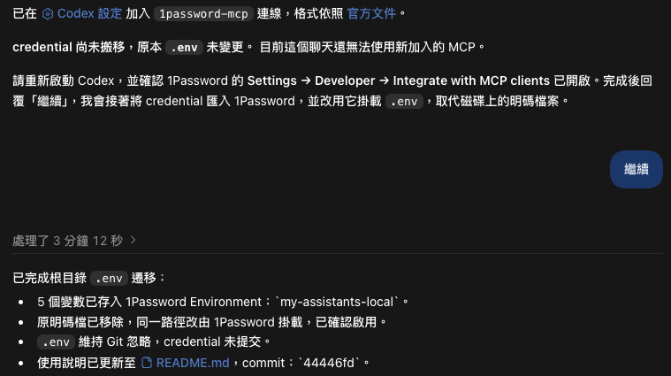

# 透過 Codex 的 1Password Plugin 遷移本機 local env 敏感資訊到 1Password 內

[原文 - 1Password is now a trusted access layer for OpenAI's Codex](https://1password.com/blog/1password-trusted-access-layer-for-openai-codex)

1Password 宣布推出 Codex 外掛程式，讓 Codex 可以透過本機 MCP Server 管理 1Password Environments，假設你剛 clone 一個需要 `OPENAI_API_KEY` 的專案，Codex 可以幫你確認開發環境裡有沒有這個變數，再把環境掛載到專案的 `.env`，等應用程式啟動時，才由程式向 1Password 讀取金鑰。

## 使用
1Password Environment 可以把同一個專案需要的環境變數放在一起，例如 API 金鑰、資料庫連線資訊等，外掛把操作這些環境的 skill 和本機 MCP 設定包在一起。

Skill 告訴 Codex 怎麼操作，MCP Server 則提供列出環境、建立環境、查詢變數名稱和掛載 `.env` 等工具。

啟用方式：
1. 打開 1Password 桌面版，到 **Settings → Developer** 開啟 **Integrate with MCP clients**
2. 到 ChatGPT 桌面版的外掛目錄搜尋並安裝 **1Password**，再從專案開一個新的 Codex 對話
3. 直接請 Codex 幫你搬 `.env`，或把你 1Password 裡面的 environment 資訊放入專案 .env

假設專案根目錄還沒有 `.env`，先在 1Password 桌面版建立 `my-app-dev` Environment，並在裡面填好 `OPENAI_API_KEY`。接著可以在專案的 Codex 對話貼上這段：

> 請使用 1Password Environments，確認 `my-app-dev` 裡有沒有 `OPENAI_API_KEY`，如果有，請把這個環境掛載到目前專案根目錄的 `.env`，完成後回報掛載路徑和變數名稱。

之後會彈出一些需要你授權 Codex 進行 1Password 的相關操作，只要授權就可以了，如果 `cat .env` 也會要你授權後才能看到，然後在 1Password 改 value 也會同步到 `.env` file。
