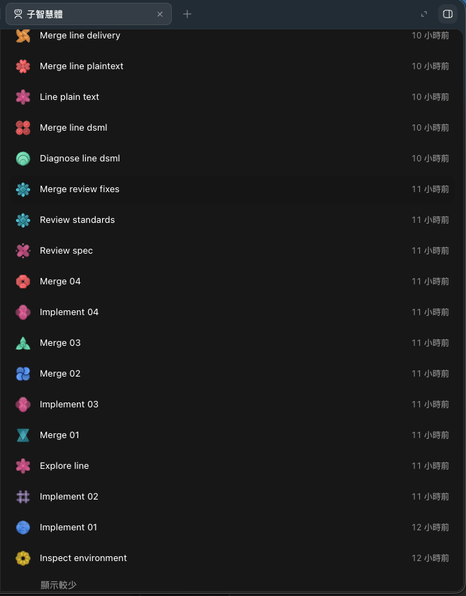
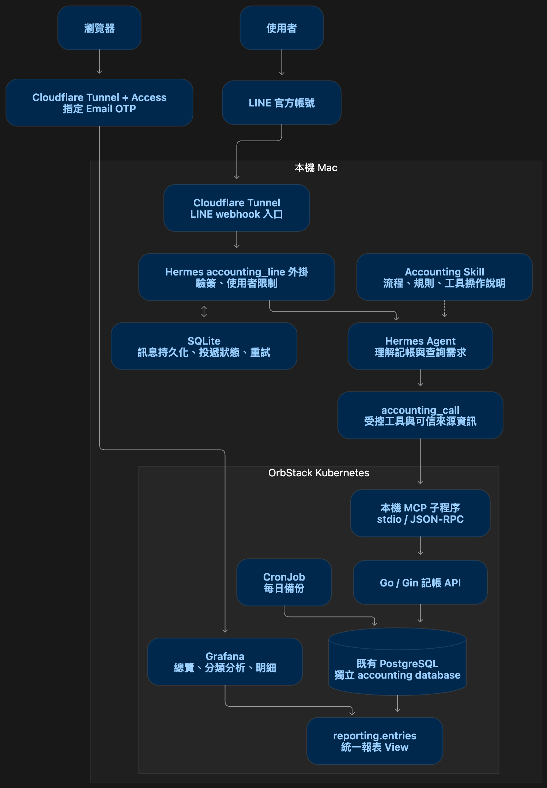
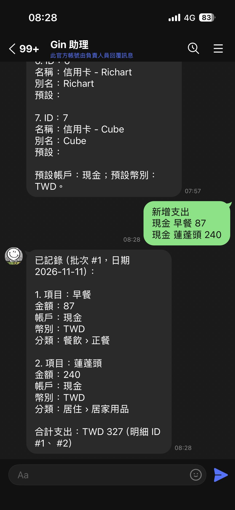
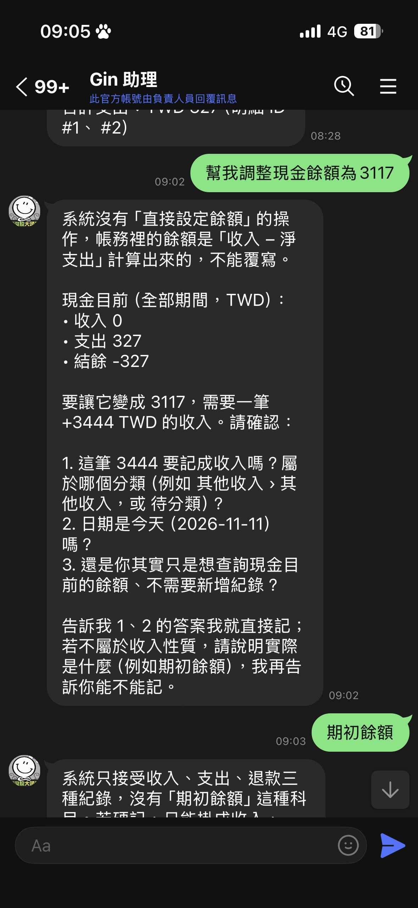
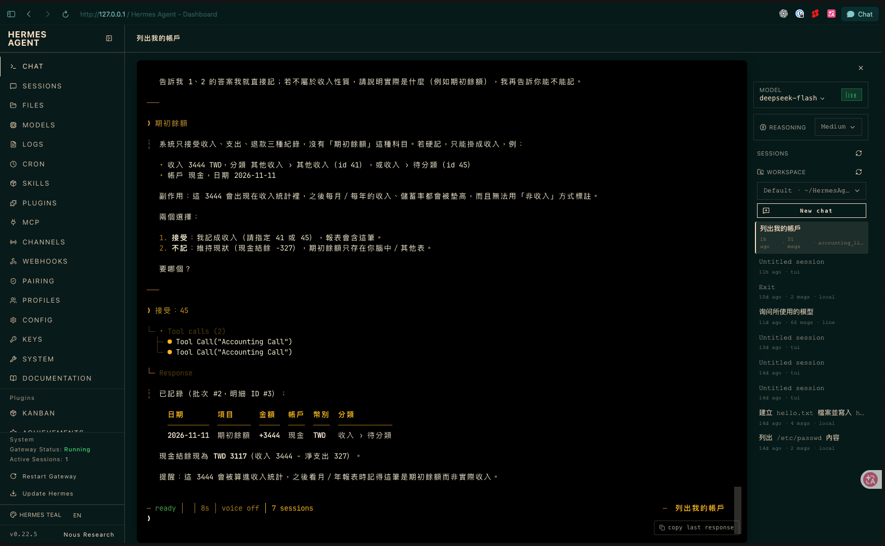
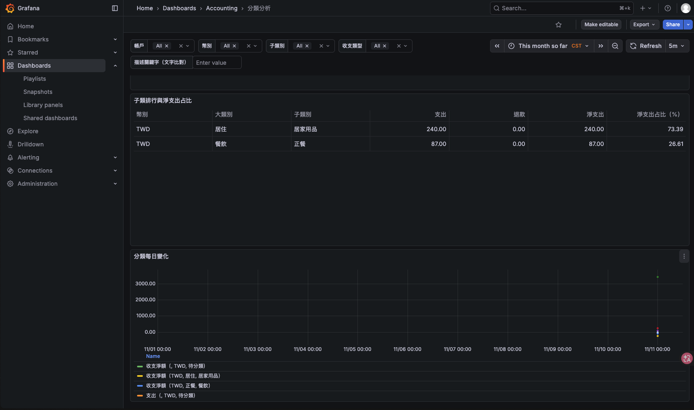
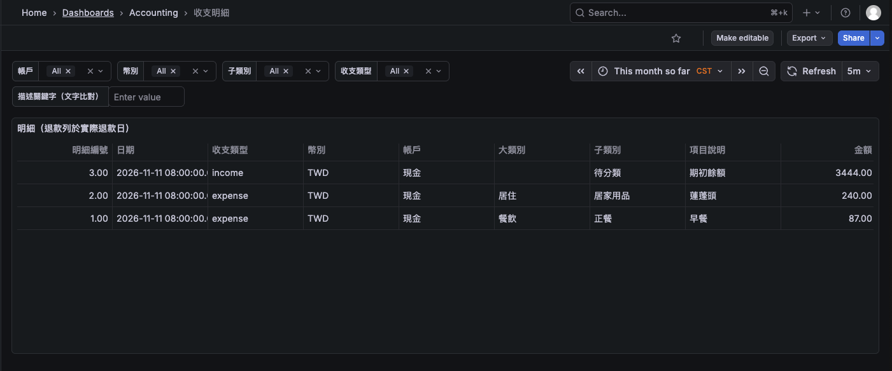

# 用 Matt Pocock 的 skills 在 2 小時內搭建完 Hermes + MCP + PostgreSQL + Grafana 的記帳系統

已經用 Matt Pocock 的 [skills v1.3](https://github.com/mattpocock/skills/tree/main/skills/engineering) 開發了一陣子，[Hermes Agent](https://hermes-agent.nousresearch.com/) 也已經架設在我的 Mac Mini 一陣子，但幾乎沒在使用，最近忽然想到乾脆來弄個紀錄消費流水的功能，直接用 `/grill-with-docs` 開始，全部交給 Agent 處理，看看需要多久能完成。

於是開啟一個新的專案，直接透過 `/grill-with-docs` 把想實作的相關功能告訴它，由它來和我確認各功能的細節，結果在 2 小時內就完成開發，期間僅使用一次 5 小時額度重置（我是 ChatGPT Plus 用戶）。

## 規格確認

直接下一個相對模糊的 prompt 由 Agent 發想與我討論：
```:no-line-numbers
/grill-with-docs

我希望透過 Hermes + 本地 PostgreSQL 資料 + Grafana 顯示我記帳的相關資訊，包含能看到每日收支、明細、每個分類不同週期的開支，每個週期的所有開支匯總報表等。

記帳以這個資料夾為主，但使用的 PostgreSQL，以目前本地已經有的 PostgreSQL，其相關設定在上一層 my-assistance 資料夾裡，我們使用該 PostgreSQL 即可。

透過 Hermes，我每天將我支出、收入透過 LINE 傳送給我的官方帳號，hermes 自動幫我分析和寫入相關支出、收入的資料到 PostgreSQL，然後我能在 Grafana 上，或者透過 hermes 查詢。

其他細節由你發想，並和我確認規格
```

Agent 一共陸續和確認了 32 題：
```:no-line-numbers
Q1 — 使用對象：第一版只供你個人使用，僅接受你的一對一 LINE 訊息，可以嗎？
Q2 — 要記到多深：第一版以「收入、支出與支付方式」為主，暫不管理各銀行餘額、信用卡欠款與資產淨值，可以嗎？
Q3 — 幣別：第一版只用新台幣，可以嗎？
Q4 — 自動入帳程度：內容明確時直接入帳並回覆明細；金額、日期或收支性質不清楚時才追問，可以嗎？
Q5 — 輸入形式：第一版先支援文字，一則訊息可包含多筆收入與支出，可以嗎？
...
Q29 — 退款限制：首版退款必須找到原支出、使用相同幣別，且累計退款不得超過原支出，可以嗎？
Q30 — 日期與幣別不明：未來日期、含糊日期或無法辨識的幣別，先確認再入帳，可以嗎？
Q31 — 故障與重試：只有資料庫確認寫入後才回覆「已入帳」；已被系統持久保存的待處理訊息，服務恢復後自動重試，可以嗎？
Q32 — 備份：首版每天自動備份 accounting 資料庫，並完成一次還原驗證，可以嗎？
```

`/to-spec` 整理成相關 specs 文件後，接著透過 `/implement-spec` 進行實作，整個過程由 Agent 自行去開 Subagent 平行開發功能、測試、驗收等。




## 架構

用 LINE 作為記帳入口，由 Hermes 理解自然語言，透過受控工具交給 Go 服務處理帳務，再由 PostgreSQL 與 Grafana 提供查詢及報表。



各元件作用：
| 元件 | 使用技術 | 負責什麼 |
|---|---|---|
| 對話入口 | LINE Messaging API | 接收記帳文字、回覆結果 |
| 對話代理 | Hermes | 理解項目、金額、帳戶、分類及查詢意圖 |
| 記帳外掛 | Python、aiohttp | 驗簽、限制使用者、串接 Hermes 與記帳工具 |
| 持久訊息佇列 | SQLite | 保存訊息、追蹤處理狀態、支援重試 |
| 操作指引 | Accounting Skill | 告訴模型何時記帳、追問、確認或查詢 |
| 工具協定 | MCP、stdio、JSON-RPC | 將 Hermes 的工具呼叫連到記帳服務 |
| 記帳服務 | Go & Gin | 驗證帳務規則、執行交易、維護歷程 |
| 帳務儲存 | PostgreSQL | 保存收支、分類、草稿、退款與稽核紀錄 |
| 報表 | Grafana | 提供總覽、分類分析、逐筆明細 |
| 遠端入口 | Cloudflare Tunnel、Access | 提供 HTTPS 與身分驗證 |

其中：
- Skill：負責告訴模型該怎麼做<br>
  例如：預設現金與 TWD、退款應連結原支出、不確定時先追問、不同幣別分開計算。
- MCP：提供結構化操作介面<br>
  例如：新增收支、列出帳戶、查詢明細、期間彙總、更正與退款，這次使用本機 stdio 傳輸，MCP 子程序再呼叫內部 HTTP API。
- Plugin：接上執行環境並建立信任邊界<br>
  它處理 LINE 簽章、使用者身分、原始訊息時間、持久化、重試，以及 LINE 純文字輸出。

以這次的訊息為例：
早餐 50 元，五金 240 元。

處理流程是：
1. LINE webhook 進入外掛，先驗證簽章及允許的使用者
2. 將原始訊息、事件 ID、訊息 ID、時間與接收狀態寫進 SQLite，才回應已接收
3. Hermes 理解成兩筆支出，選擇帳戶、幣別與分類
4. 外掛從已驗證的接收紀錄補上可信來源資訊，產生簽章證明
5. MCP 將結構化參數交給 Go API
6. Go 服務驗證後，在同一個 PostgreSQL transaction 寫入批次、兩筆明細與稽核資料
7. 工具回傳成功，Hermes 才回覆批次編號、明細與合計
8. Grafana 經由報表 View 讀到這些資料

## 一些細節

1. 讓模型負責理解，讓程式負責帳務正確性<br>
    退款是否超過原支出、分類是否存在、作廢是否已確認，都由服務與資料庫檢查，即使模型選錯參數，也不應繞過這些限制。<br>
    未來換代理、換模型、換 Hermes，帳務核心仍可保留。
2. 幂等性，避免重複入帳<br>
    把收到訊息、記帳成功、回覆成功分成三件事，LINE webhook 收到 HTTP 200，只代表訊息已持久保存，不代表資料已入帳。<br>
    資料庫提交成功後，LINE 回覆仍可能失敗，因此系統保存原始訊息 ID（LINE Webhook Event ID、`message.id`），靠這些 ID 來實現 idempotency，避免因為「剛才沒收到回覆，再處理一次」而重複記帳。
3. 建立明確的報表語意<br>
    資料庫提供 reporting.entries View，統一定義：
    - 支出、退款與淨支出
    - 作廢資料不列入報表
    - 退款歸屬實際退款日期
    - 各幣別分開彙總
    - 日期採用 Asia/Taipei 與收支發生日

    Hermes 查詢與 Grafana 都依這份語意取得結果，降低發送聊天給一個數字，報表卻是另一個數字的機率。

## 實際使用效果

Hermes 模型我選用 DeepSeek V4 Flash，主要是因為便宜、中文理解較佳，CP 值比較高，另外我只拿來紀錄一下日常流水花費，並沒有包含一些隱私資訊，特殊花費也不會透過這個紀錄，而是保留 Excel 記帳 & 對帳，記下來一筆大約 0.05 台幣，隱私就不成問題。實際使用下來，單純記帳一天大概是 0.3 台幣，我 Hermes 目前只拿來記帳，沒做其他任何事情。

對了，如果用不到 Hermes 其他工具、skills，記得關一關，否則 token 消耗很驚人。

對話效果如下：




Agent 遇到它不確定的部分，都會再詢問細節和你確認，確認後才會記入資料庫，然後只要寫支出名稱，就會按照它理解的語意，對照目前有的支出和收入分類，幫你選擇合適的分類，例如圖左早餐自動幫我分到正餐，蓮蓬頭則幫我分類到居家用品。

Hermes：


Grafana 上查看圖表：

