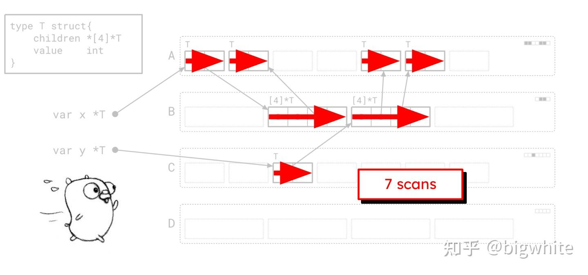
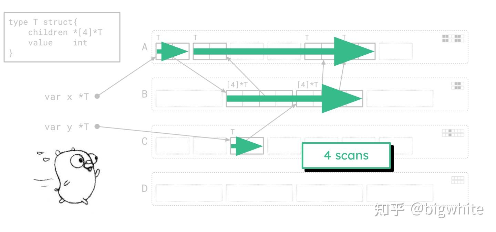

# Golang 1.26 Green Tea GC

剛好在社群看到有人在討論 Green Tea GC，所以特地去了解一下。

## Green Tea 之前的 Go GC

- **Go 1.3** 開始讓清掃（sweep）和程式並行執行，標記過程需要 Stop-The-World（STW），縮短回收時的暫停，約幾百毫秒
- **Go 1.5** 改用並行的三色標記清掃（concurrent tri-color mark-sweep），GC 可以一邊追蹤哪些物件還能被程式存取，一邊讓 goroutine 繼續執行，大幅縮短暫停時間，約幾十毫秒
- **Go 1.8** Hybrid Write Barrier，移除標記結束時需要暫停整個程式的 stack 重掃，時間耗費 < 1ms
- **Go 1.19** 加入 `GOMEMLIMIT`，讓 Go runtime 能依據記憶體的軟上限調整 GC 頻率

## 為什麼需要 Green Tea GC？

即使 GC 已經能和程式並行執行，掃描物件仍然會消耗 CPU，舊版 GC 以物件為單位安排掃描工作，沿著指標找出下一批要掃描的物件，互相引用的物件可能散落在 heap 各處，這會導致 CPU 頻繁跳到不同位址讀資料：
- 同一邏輯上相鄰的物件，其記憶體訪問可能跨越很大範圍
- 對同一記憶體區域的重複訪問分散在整個 GC 週期，無法有效利用 cache

Green Tea 沿用標記清掃，並把小物件的掃描工作按記憶體頁分組，掃描時 GC 會一起處理同一頁上已找到、尚未掃描的物件，這些物件的位址彼此接近，更容易用到 CPU 快取，工作佇列也能用一個頁面項目代表多個待掃描物件，減少佇列操作和 worker 之間的競爭。Green Tea 在 Go 1.25 以實驗功能推出，在 Go 1.26 變成預設，Go 團隊預期在 GC 負擔較重的實際程式中，**GC 本身的開銷可降低約 10–40%**。[Go 1.26 Release Notes](https://go.dev/doc/go1.26#new-garbage-collector)

實際步驟可以參考：
- [The Green Tea Garbage Collector - The Go Blog](https://go.dev/blog/greenteagc)
- [Go 官方详解“Green Tea”垃圾回收器：从对象到页，一场应对现代硬件挑战的架构演进](https://zhuanlan.zhihu.com/p/1967490735994564792)

新舊 GC 的 scan 次數比較：

## References
- [The Green Tea Garbage Collector - The Go Blog](https://go.dev/blog/greenteagc)
- [Go 新垃圾回收器登场：Green Tea GC如何通过内存感知显著降低CPU开销？](https://tonybai.com/2025/05/03/go-green-tea-garbage-collector/)