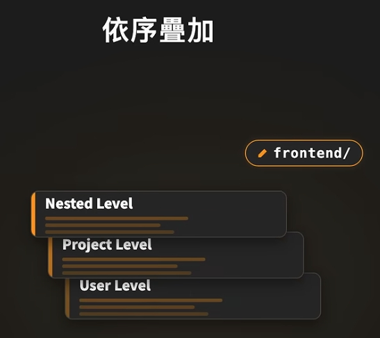

# CLAUDE.md & AGENTS.md 設定筆記

檔案存放的位置會分成不同的 Level：

- User Level
   - 路徑：`~/.claude/CLAUDE.md`
   - 這台電腦與 claude 的對話都會吃到這個檔案
- Project Level
   - 路徑：`~/my_project/CLAUDE.md`
   - 在這個專案底下進行對話，這個檔案都會被帶進去
   - 通常會放入 Git，讓團隊成員都吃到一樣的條件
      - 個人有一些癖好則可以放到 `~/my_project/CLAUDE.local.md`
         - 讓這設定只留在個人本機裡
- Nested Level
   - 路徑：`~/my_project/frontend/CLAUDE.md`
      - 更細項，例如給 frontend 的
   - 路徑：`~/my_project/backend/CLAUDE.md`
      - 給 backend 的


## 疊加

如果修改 `~/my_project/frontend` 前端的東西時，會先加載：

1. User Level
2. Project Level
3. Nested Level → 這個會離改的專案最近，影響會最大




## 建立 CLAUDE.md

可以至專案底下，在 claude 輸入 `/init` 指令，會幫你初始化。

裡面通常會有：

```go
## 專案介紹
## 常用指令
## 技術架構
## 開發規範
```

但初始化的東西太細，當你給 claude 指令時，它不會盲寫，會在背景啟動一個 **Explore Subagent** 去讀相關檔案 `package.json`, `tests/` 等檔案了解專案架構，此時在 CLAUDE.md 又有相關資訊，會導致 context 有過多重複資訊，從而導致：

1. 浪費 token
2. 檔案過期，沒改 CLAUDE.md 反而誤導後面的 AI
3. 還會影響 Instruction Budget


AI 的 2 種容量：

1. Context Window
   - 決定一次能看多少資料
2. Instruction Budget
   - 決定能同時顧好多少條件
   - 太多會導致真正重要的條件可能被忽略（注意力會下降）


## 調整

### 減法

如上面所說，用 `/init` 建立的 CLAUDE.md 應該一條一條檢查，問自己 3 個問題：

1. Explore 自己找的到嗎？
   - 能快速找到的就不要再額外寫
   - 僅保留隱形知識、藏在程式碼深處的資訊
2. 這條規則是大部分場景都會用到嗎？
   - 僅特定領域、場景會用到，就應該放在對應的地方，例如：修改前端畫面後，執行視覺測試，僅跟前端有關就應該放在 `/frontend/CLAUDE.md`
3. 過幾個月後還成立嗎？
   - 例如：暫時使用舊版 API，僅這幾週、幾月會用到，一直留著可能會導致未來 AI 會繼續照著過期的做法工作


### 加法

1. **有沒有不能搞錯的規定？**<br>
   假設做網路商店，所有對顧客顯示的價格都必須為含稅價格，那就適合寫入規則
2. **有沒有什麼事情有一套固定的處理方式？**<br>
   如果修改這家商品產品的價格都要先修改到試算表，再同步到網站，如果直接修改網站上的數字，下次改試算表再同步到網站時，之前改的可能就被覆蓋掉了。
   此時就應該提醒 claude，要先改試算表，再改網頁內容。
3. **改了這個，還要改什麼？**<br>
   容易漏掉的連動關係，例如：會員價格調整後，首頁、結帳頁面、常見問題、通知都要一起更新。
4. **怎樣才算做完？**<br>
   每次都要完成的檢查，可以先寫清楚。
   例如：改完網站畫面後，要同時檢查電腦版、手機版，修改購買流程後，要實際下一筆測試訂單。
5. **不知道的事，去哪裡查？**<br>
   只寫文件位置，不寫內容。
   例如：寫網站文案，就去看品牌指南，處理退款，就去看退款規則。


### 結論

一份好的 CLAUDE.md 主要留下：
- 不能搞錯的規定
- 固定的處理方式
- 容易漏掉的連動關係
- 完成前的檢查
- 重要資料的位置


那些減法刪掉，但卻還有用的資訊，應該移動到其他位置，例如：
- 客觀現狀 → **Explore Subagent 自己找**
- 前端視覺測試 → **放入 Nested 對應的位置**
- 內容多但使用頻率少，僅特定流程才會需要 → **做成 Skill**
   - 例如：程式發布新版本時，有十幾個項目需要依序檢查，等真的要發布時，手動或自動調用
- <span class="text-red">不允許發生的情況</span> → **寫成 Hook**
   - 例如：API Key 不能放進 Git
   - 如果僅在 CLAUDE.me 裡，寫入這條規則，模型處理複雜任務時，仍可能漏掉這條規則


## 維護

每次 Claude 犯錯就補上一條規則，久了 CLAUDE.md 又會變複雜、變肥，最終 Claude 腦袋又會被塞滿。

### 新增

**如何知道自己與 Claude 互動過程，哪些問題一直重複發生？**

Claude 可以透過 `/insights` 分析歷史紀錄，產生一份 HTML 報告，了解自己的使用模式，例如：

- 使用習慣：一次到位還是分批修改
- 重複的模式：重複提醒 claude 檢查的檔案
- **提供建議**：某個要求被重複提醒很多次，這份報告會產生一段可以直接貼到 CLAUDE.md 的規則

<span class="text-red">Codex 沒有這個指令，只能使用第三方提供的方式產生。</span>

如果已經使用一段時間，建議跑一次 `/insights` 僅增加那些真正需要的規則。


### 修剪

我們習慣增加規則去限制 AI，但卻不敢**刪除既有規則**。

然而有 2 種規則，應該要勇敢修剪：
1. **模型變強了，而不再需要的規則（Overconstraining）**<br>
   舊模型是護欄，幫助 AI 少犯錯，新模型會觀察你的使用習慣和偏好，舊有的規則反而變成枷鎖，[Claude 官方部落格](https://claude.dev/blog/the-new-rules-of-context-engineering-for-claude-5-generation-models/) 指出他們把 Claude Code 的系統提示詞砍掉了將近 80%，AI 卻完全沒有變笨。

   因此 <span class="text-red">不同的模型也會影響 CLAUDE.md 該保有的對應的規則</span>，然而我們很難知道模型到底變多強，最好的方式是**參考官方的 Prompting Guide**。
2. **與現實不符**<br>
   要去檢查專案現狀，與真實情況不符的應該移除，例如從 `npm text` 改成用 `vitest` 了，避免誤導 AI。


### CLAUDE.md 與 AGENTS.md 同步

一個做法是在 `CLAUDE.md` 或 `AGENTS.md` 裡面去 reference 另一份，去讀到真正有在維護的 single source of truth。

## Reference

- [Gary AI](https://www.youtube.com/watch?v=wj7mHCviMvs)