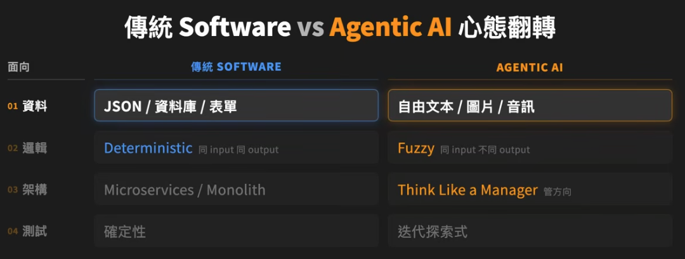
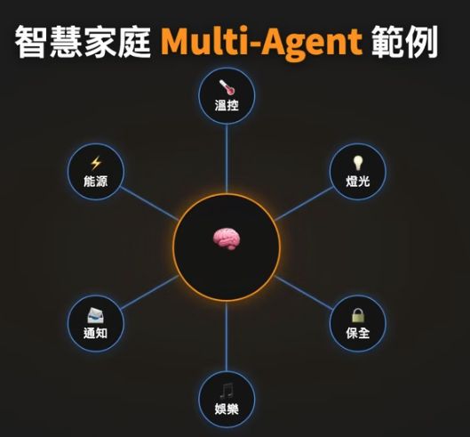

# Stanford Beyond LLM 課程影片筆記

LLM 變強的 2 條路：
1. 更強的 base model
   - 例如替換 GPT-4 到 GPT-5，但這是 AI 模型公司 OpenAI、Anthropic 在做的事情，一般人沒有能力和金錢去處理
2. Augmenting LLMs
   - 在現有的 LLM 上疊工程技術，來提升 model 能力
      - Agentic Workflow
      - RAG
      - Prompt Engineering

## Base model 限制

1. 缺乏 Domain Knowledge
   - 例如某些資料市面上根本沒有
      - 農業病害 dataset
      - 公司資料
      - 內部文件
      - 產品規格
   - Base model 根本不知道，無法幫你做到這件事

2. 資訊落後
   - 模型知識受訓練資料截止時間限制，不能保證知道最新事件

3. 控制很難
   - LLM 是機率性輸出
      - 在真實產品環節，遇到「我要退費」，AI 可能一下說可以，一下說不行

4. Lost in the middle
   - 當 context 太長，模型表現會退步，雖然主流模型的 context window 已經來到 1M token，但還是會丟失一些信息


## Prompt Engineering

### 三要素

好 Prompt 的三要素：

1. 對象
2. 格式
3. 重點

- Bad
   - 請幫我總結這篇文章
- Good
   - 請將這份論文，整理成 5 個重點摘要，並且聚焦在其背後的政策意涵上
   - 對象：政策制定者
   - 格式：5 個重點
   - 重點：政策意涵

### Prompt Chaining

把一個複雜的 Prompt 拆分成多個獨立的 prompt，將一個 output 餵 input。

例子：客戶回信

- 單一 Prompt
   - 讀這封投訴信，寫一封專業的回應
- Prompt Chaining
   1. Extract: 客戶抱怨重點
   2. Draft: 起草回應大綱
   3. Write: 大綱 → 完整回信

如此<span class="text-red">每一步都可以獨立測試、獨立 debug</span>。


### BCG 案例

[https://youtu.be/eKW9ITaltWw?&t=240](https://youtu.be/eKW9ITaltWw?si=ca9iNS0hm_yBDGaY&t=249)

三組顧問實驗：
1. 沒有 AI
2. 可用 ChatGPT
3. ChatGPT + 提示詞訓練

研究結果發現：

1. The Jagged Frontier 鋸齒邊界
   - AI 不是在所有任務都表現很好，有些任務 AI 顯著加分，有些則拖後腿
2. Falling Asleep at the Wheel
   - 中文：打盹的駕駛
   - 盲目信任 AI 產出，比沒用 AI 還慘
3. Centaurs vs Cyborgs
   - 半人馬 vs 生化人
      - 半人馬：分工委派型，丟長 Prompt 給 AI，自己去做別的事
      - 生化人：高頻來回型，和模型一句一句對話協作


#### 結論

1. 要知道 AI 模型邊界，在適合的場景選擇使用，AI 弱項的部分則不依賴 AI
2. 不應該盲目信任 AI 產出
3. 應依據任務性質選擇 Centaur 或 Cyborg，要有意思切換
   - Centaur 適合重複性高、流程清楚的任務
   - Cyborg 適合判斷、創意、來回校正的任務

## Fine-Tuning

能不做就不做，4 個原因：

1. 數據成本
   - 高品質標注資料 = 一般人付不起
2. 容易 overfit
   - 失去通用的廣度，會變成專用特定的模型
3. 時效性差
   - 兩個月後可能新模型就直接打贏，投入過期
4. Prompt Engineering 通常可以解決


但有些場景還是適合 fine-tuning

- 嚴謹一致性的需求
   - 法律
   - 科學
- Domain 訓練資料稀少


## RAG

如果 Prompt 塞不下、Fine-Tune 不划算，那麼 RAG, Retrieval-Augmented Generation 就很適合。


#### RAG 解決的痛點

- Context Window 太小，塞不下完整資料
- 長 context 抓不準， Lost in the middle
- 資訊有時效性（訓練資料會過期）
- 模型會幻覺

#### RAG 流程

以藥物副作用場景來說，先把所有資料透過 Embedding Model 轉換成向量，存入向量資料庫：

文件 → Embedding model → \[12.03, 42.5, 203.1, 592\] → Vector Database

使用者詢問藥物的不良反應時：
Query 轉向量 → 距離 metric 比對 → 找出相近 documents → 找到的 Documents + System Prompt + User Query 組合 prompt → 餵給 LLM


RAG prompt template：

```plain
根據以下 documents 回答使用者的問題，如果 documents 裡沒有答案就說「我不知道」。
```

RAG 提供可依據的資料，有助於降低幻覺，但仍可能找錯資料、漏掉關鍵段落，或讓模型誤讀內容，因此需要分別檢查檢索與回答品質。

1. 資料庫裡有沒有答案？
2. 有答案，但 retrieval 有沒有撈到？
3. 撈到了，模型有沒有正確引用與解讀？

#### Chunking

整份文件直接轉向量很多細節會遺失，所以通常會搭配 chunking，最基本的 chunking 就是把文件切成固定大小的片段，每段各自轉成向量


#### 多層次儲存：整篇/章節/段落

更進階的 chunking 方式，依照章節、段落進行，如此多層次存儲，同時保留：整篇文件、章節、段落，在進行 retrieval 時，可以找到相關章節，再往下找到段落。


#### Long Context vs RAG

現在模型都支援 long context，如果未來支援夠長 context，算力也夠便宜，那麼就不需要 RAG？

即便模型已經支援 1 Million 的 context，實際的使用狀況 smart zone 也大概 150K 上下，持續使用下去過長的 context，仍會導致 AI 遺忘部分訊息。

其次在這些場景下，RAG 可能還是會表現的比 Long Context 好：
- 檢索效率
   - 每次問問題模型需要把整個 google drive 讀一次
   - RAG 相當於先建立好索引
- 準確度
- 即時更新


---

LLM 還是有做不到的事情：
- Agentic Workflow
- Evaluation
- Multi-Agent

| 遇到的問題 | 優先考慮 |
|---|---|
| 任務要求不清楚、輸出格式不對 | Prompt Engineering |
| 複雜任務一次做容易漏步驟 | Prompt Chaining |
| 缺少公司內部資料、需要最新資訊 | RAG／資料查詢工具 |
| 要查訂單、取消預約、實際操作系統 | Tools + Workflow／Agent |
| 已有足夠範例，希望穩定學會特定行為 | 評估 Fine-tuning |
| 不知道改動有沒有變好 | Eval |

不需要從 Prompt 一路升到 Multi-agent，而是要先找出失敗原因，再選擇能解決問題的最簡單方法，大道至簡。

---

## Agentic Workflow

<span class="text-red">提示詞 + 工具 + 元件 = Agentic Workflow</span>，想像一下如果我們有取消退單的請求，傳統 RAG 只能根據用戶請求內容，給出對應的文件給用戶，實際後續流程用戶需要自己找的對應的人、系統進行操作，然而 Agent 系統就能完成一系列操作。

Workflow 是程式預先決定步驟，LLM 負責其中幾個環節，Agent 則讓模型依據目前結果，決定下一步要做什麼、呼叫哪個工具，以及何時停止，兩者可以混用。

```
RAG
收到請求 -> 返回政策文件

---
Agent 系統
RAG retrieve 政策 -> 主動問訂單編號 -> Tool 查訂單 -> 確認退費 -> 告知 3-5 工作天
```

RAG 是<span class="text-red">工具</span>，Agent 是<span class="text-red">使用工具的系統</span>。




### 不要把所有事情丟給 LLM

能 deterministic 解就應該用 deterministic 解，規則能做的就交給規則，而不是全部丟給 LLM，剩餘 fuzzy 的部分加上護欄。

以教授自己的例子，Skills Assessment 題型：

- Deterministic 算分
   - 選擇題
   - 配對題
   - 拖拉題
- Fuzzy（LLM 判斷）
   - 語音題
   - 語音 + coding 混合

由於 LLM 一定會誤判，所以教授給 AI 上護欄的具體形式：
- 受測者可以提出申訴，接著由真人介入評分

不是試圖讓 AI 零錯誤，而是讓錯誤發生時，有人接得住


### Agent 三要素

1. Prompts
   - 角色是什麼
   - 能做什麼
   - 不能做什麼
2. Context Management
   - 包含：
      - Memory + 對話歷史
         - Working Memory（當下）
            - 高頻
            - 要快
            - 例如：
               - 使用者名字
               - 訂房的目的地在哪
         - Archival Memory（歷史）
            - 低頻
            - 可以慢
            - 需要的時候再去撈
            - 例如：
               - 過去 5 年訂房紀錄
      - RAG 撈回的資料
      - 有限 context window
   - 對的資訊，在對的時間給 Agent
3. Tools
   - 也就是 Agent 能呼叫的外部能力
   - 分為：
      1. 做事的（action）
         - Flight Search
         - Hotel Booking
         - Payment
      2. 查資料的（lookup）
         - CRM 客戶資料
         - 資料庫訂單

### Agent 自主性三層階梯

1. Hardcoded steps（步驟全寫死，照順序走）
2. Hardcoded tools（工具固定，agent 自選步驟）
3. Fully autonomous（自主決策範圍最大，能力最強/風險最高）

### MCP, Model Context Protocol

- 傳統作法
   - 每個 API 單獨寫串接

- MCP
   - 中間層協議
   ```plain
   Agent <-> MCP <-> API 1 / API 2 / API 3
   ```

## Eval

如何知道 AI 上線之前是否有問題？透過 Eval 不管 single or multi-agent 上線前都要先回答。

### 3 維度交叉框架

1. 整體 & 組件
   1. End-to-End（看整體）
      - 整體分數
      - 使用者滿意度
   2. Component-based（看細節）
      - 拆每一步看
2. Objective 客觀 & Subjective 主觀
   - 程式能否自動判斷對錯？
      - Objective 客觀可量化
         - 例如：使用者說 order ID `X`，寫進 DB 變 `Y`，這種可以寫 Python Script 自動對齊
      - Subjective 主觀
         - 難以用單一規則判定，需要明確標準與判斷
         - 語氣/同理心
   - 引入人工或另外一個 LLM 當作評審（LLM-as-Judge）
3. Quantitative & Qualitative
   - Quantitative 量化
      - 數字
      - 例如：做某一件事成功率幾 %，每個環節延遲多久
   - Qualitative 質化
      - 感覺
      - 例如：在哪裡幻覺、語氣哪裡不對、哪裡有卡點
      - 需要人工一筆一筆看

### LLM-as-Judge 的 4 種玩法

1. Pair-wise comparison
   - 給 judge 兩種答案，問他哪個比較好
2. Single-answer grading
   - 直接打 1 到 5 分
3. Reference-guided pair-wise
   - 多給標準答案做對比，評分更有依據
4. Rubric-based
   - 自訂定義評分標準（5 分 / 0 分各長什麼樣）
   - 例如 5 分 = 100 字 + 3 重點 + 一句 overview，0 分 = 答非所問


### Subjective Eval 4 步驟

以 travel agent 禮貌度為例

1. Error Analysis
   - 從 1000 個對話抽 20 個人工讀，找錯
   - 先知道問題才能找出正確的 eval
2. 設計 Eval
   - LLM-as-judge + 自己寫的禮貌度 rubric
      - 5 分
        - 100 字以內
        - 含 3 個重點
        - 第一句是 overview
      - 0 分
        - 答非所問
        - 冗長失焦
3. A/B Test 模型
   ```plain
   固定變因（同一個 prompt） -> 換模型 (GPT vs Claude vs Gemini) -> 同一批對話 -> Judge 評分
   ```
   看哪個禮貌度最高
4. A/B Test Prompt
   測試不同 Prompt 的影響


核心原則：

1. 先人工掃除問題，在設計自動化 eval
2. 模型 / prompt 一次只動一個變因


## Multi-agent 平行處理

Multi-agent 存在的一個主要原因為平行處理，有些事情不需要等待，例如：

```plain
找航班 -> 找飯店 -> 查天氣
```

如果一件一件做，在企業應用端 AI 場景來看太慢了，三個 agent 同時各自去做速度大幅度提升。


次要原因：Reusability

- 例如某個 agent 可以給公司兩個團隊用，但要做的時候要問自己，是否真有其必要性？





可以分爲：

- Hierarchical 中心化
   - 一個主要角色 + 各組件可以 P2P 溝通
   - 使用者 → Orchestrator → Agents
   - 以家電控制來說就適合 Hierachical，因為你只想跟中控講，由中控去控制對應組件

- Flat 去中心化
   - \[Agent A <-> B\] → \[Agent B <-> C\] → \[Agent A <-> C\]
   - peer to peer


## 總結

打造 AI 產品的成功路徑應遵循：<br>**任務拆解 (Task Decomposition) → 選擇合適工具 (RAG/Tool/Prompt) → 建立評估系統 (Eval)**。

## Ref
[一部影片看完 Stanford AI 系統課程，從 LLM 到 Agentic Workflow](https://www.youtube.com/watch?v=eKW9ITaltWw&list=WL&index=80)